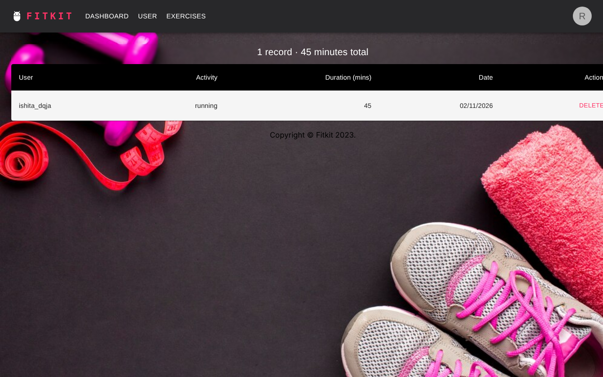
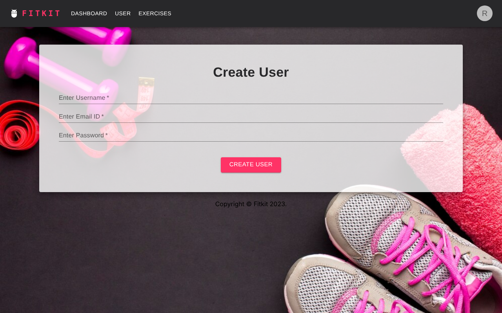
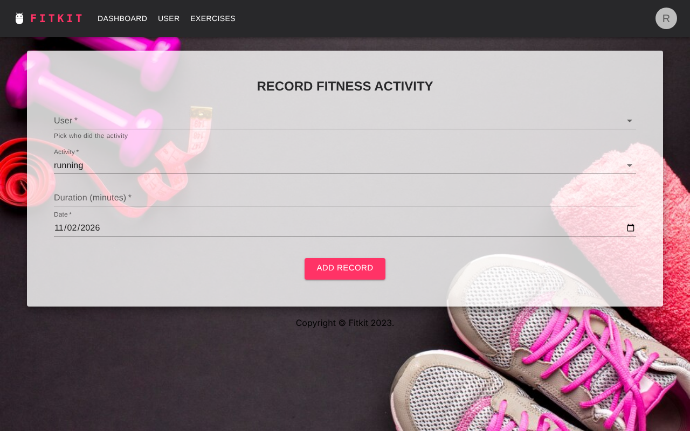

# Fitkit

A small MERN fitness tracker: create users, record their workouts, and see everything on one dashboard.

> **Provenance.** Fitkit was my Back End Engineering course project at Chitkara University (Sem 5, Nov 2023 – Jan 2024).
> The frontend was committed to GitHub in March 2024; the backend only ever lived on my laptop.
> In November 2026 I brought the two halves together, wired the UI to the API, fixed the security and
> data-freshness problems described below, and pushed it so the project actually runs from a clone.
> It is a college project made presentable, not a reflection of how I build things at work today.



## Stack

| Layer | Tech |
|---|---|
| Frontend | React 18, React Router 6, MUI 5, Axios (Create React App) |
| Backend | Node.js, Express 4, express-validator, bcryptjs |
| Database | MongoDB (Atlas or local) via Mongoose 8 |
| CI | GitHub Actions – client build + API smoke test |

## Features

- Create a user with server-side validation (username ≥ 3 chars, valid email, password ≥ 5 chars); duplicate usernames are rejected with a 409.
- Record an activity (type, duration, date) against an existing user — the API refuses records for users that don't exist.
- Dashboard lists every record newest-first with a running total, and deletes a record in place.
- Every form shows the API's actual validation messages instead of failing silently.
- `npm run smoke` drives the whole API flow end to end (health → create user → duplicate → validation → record → list → delete).

## Screenshots

| Create user | Record activity |
|---|---|
|  |  |

## Run it locally

You need Node 18+ and a MongoDB connection string (a free Atlas cluster or a local `mongod`).

```bash
git clone https://github.com/ishitasharma999/fitkit.git
cd fitkit

# 1. API
cd server
cp .env.example .env        # then put your MONGO_URI in .env
npm install
npm run dev                 # http://localhost:5000

# 2. Client (new terminal)
cd client
cp .env.example .env        # REACT_APP_API_URL defaults to http://localhost:5000
npm install
npm start                   # http://localhost:3000
```

`.env` files are gitignored. The CI workflow reads the connection string from a `MONGO_URI` repository secret instead.

### API

| Method | Path | What it does |
|---|---|---|
| `GET` | `/api/health` | liveness check |
| `GET` | `/api/users` | list usernames |
| `POST` | `/api/users` | create user `{username, email, password}` |
| `GET` | `/api/exercises` | all records, newest first |
| `POST` | `/api/exercises` | create record `{username, activity, duration, date}` |
| `DELETE` | `/api/exercises/:id` | delete a record |

Errors always come back as `{ "errors": ["message", ...] }` with a 400/404/409/500 status, so the client has one code path for showing them.

## A design decision, and the bug behind it

The original backend read the entire `exercises` collection into a global variable **once, at startup**, and
`GET /exercises` returned that variable. It looked like a cache; in practice it meant a record you had just
added didn't show up until the server restarted, which is exactly the bug I kept hitting in demos and
blaming on the frontend.

The fix was to delete the cache and let each request query Mongo (`Exercise.find().sort({ date: -1 })`).
For a dataset this size an indexed query costs nothing, and correctness beats a premature optimisation
that was never measured. If the list ever did get slow the right tools are pagination and a `date` index,
not an in-memory copy that silently goes stale. The same pass replaced plaintext passwords with bcrypt
hashes, moved the connection string out of source and into `.env`, and gave every route a single
`{ errors: [...] }` error shape so the UI could show real messages.

## What I'd do next

- Login + JWT so a user only sees and edits their own records (the schema already stores a password hash).
- Store `userId` on records instead of `username`, so renaming a user doesn't orphan their history.
- Replace the hotlinked feature images on the home page with assets in the repo.

## License

MIT
